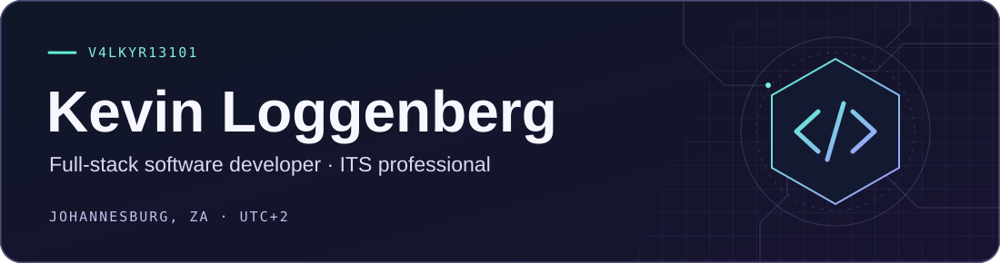

  

  
  
  
  

I build software across the web, desktop, mobile and embedded devices. My projects range from a workout tracker that follows a session onto a watch to a Pico on my desk that shows how this portfolio is doing.

## ✦ Projects

Newest first. Select any row to open the project.

<picture></picture> &nbsp; A company-scoped WhatsApp messaging service &nbsp; <code>Messaging</code>

An ASP.NET Core and Blazor Server application that wraps <code>wacli</code> so companies can manage multiple WhatsApp numbers, team access, API keys and webhook endpoints within their own workspace.

[Source on GitHub](https://github.com/V4LKYR13101/WA_TENANCY)

<picture></picture> &nbsp; Run .NET apps and restore databases in Docker &nbsp; <code>Dev Tools</code>

I built a Windows tool for spinning up local test environments from a .NET project or a published build. You can run the application, restore a database copy, or bring both up together. Each workspace keeps its containers, ports, logs and backup history in one place.

For recovery drills, it restores MySQL or SQL Server backups into separate containers and reports checks such as backup checksums, restored data comparisons and HTTP smoke tests individually.

 &nbsp; ASP.NET Core &nbsp;  &nbsp;  &nbsp; SQL Server

[Project walkthrough and screenshots](https://kevlog.co.za/projects/smoke-jumper/) · [Backup and recovery write-up](https://kevlog.co.za/blog/smoke-jumper-backup-recovery/)

<picture></picture> &nbsp; A desktop workspace for developing on the Raspberry Pi Pico &nbsp; <code>Dev Tools</code>

I built Pico Studio to bring device files, a Python editor, diagnostics and the USB console into one desktop app. It can listen to a running board as soon as it connects. You enter the REPL explicitly when you need file access.

The editor includes syntax checks and Pyflakes diagnostics. You can transfer folders and ZIP archives and opt into live monitoring for heap usage, filesystem space and clock frequency.

 &nbsp; Tkinter &nbsp;  &nbsp; pyserial &nbsp; mpremote

[Project walkthrough and screenshots](https://kevlog.co.za/projects/pico-studio/)

<picture></picture> &nbsp; Portfolio analytics on a Pico e-paper screen &nbsp; <code>Embedded</code>

A Raspberry Pi Pico 2 W pulls aggregate analytics from my portfolio and cycles through daily, weekly, monthly and all-time views on a 2.13-inch Waveshare e-paper panel. It shows browser views, visitor estimates and download starts.

The firmware uses partial refreshes for routine updates, remembers multiple Wi-Fi networks and shows the last reading as stale if it loses access to the API. A setup portal lets me configure the device from a phone.

 &nbsp;  &nbsp; Waveshare e-paper

<picture></picture> &nbsp; A self-hosted portfolio, blog and writing studio &nbsp; <code>Web</code>

I built the site behind this profile as a place to document projects, share technical notes and publish interactive examples. It has a SQLite-backed CMS for editing articles and project galleries, searchable topics, and aggregate analytics that also power my e-paper display.

 &nbsp;  &nbsp; 

[Live portfolio](https://kevlog.co.za/) · [Blog](https://kevlog.co.za/blog/)

<picture></picture> &nbsp; Local-first strength training with a 3D muscle map &nbsp; <code>Fitness</code>

I designed Forge to keep workout logging close to the session, whether you have your phone or just your watch. It spans Android, Windows and the web, with a native Wear OS companion for logging sets and tracking rest timers.

- A 3D Strength Map shows progression by muscle group.
- An optional AI coach uses your own provider key and lets you review proposed changes before applying them.

[Project walkthrough and screenshots](https://kevlog.co.za/projects/forge/)

<picture></picture> &nbsp; A terminal client that gives OpenClaw local tools &nbsp; <code>AI Clients</code>

K2.Python streams replies from a self-hosted OpenClaw gateway into the terminal and accepts text or voice input. Its tool layer lets the agent work in a local development environment by reading and editing files, running shell commands, using Git and making web requests.

 &nbsp; WebSockets &nbsp; 

[Source on GitHub](https://github.com/V4LKYR13101/K2.Python)

<picture></picture> &nbsp; Reusable capabilities for self-hosted agents &nbsp; <code>Automation</code>

A collection of installable agent skills, including a fitness data connector that retrieves metrics such as steps, distance and active minutes.

[Source on GitHub](https://github.com/V4LKYR13101/Skills)

<picture></picture> &nbsp; An Android voice and chat client for OpenClaw &nbsp; <code>AI Clients</code>

A .NET MAUI client for talking to a self-hosted OpenClaw agent from Android. I built a messaging-style interface with voice input, spoken replies and a persistent WebSocket connection that can run in the background.

 &nbsp;  &nbsp;  &nbsp; WebSockets

[Source on GitHub](https://github.com/V4LKYR13101/K2.Maui) · [Portfolio screenshots](https://kevlog.co.za/projects/k2-maui/)

<picture></picture> &nbsp; Conversational interview practice and job discovery &nbsp; <code>Recruitment</code>

At Dynamic Data Technologies, I helped design and develop a recruitment platform with spoken interview simulations, adaptive follow-up questions and candidate reports. The platform also includes map-based job discovery, PayFast payments and scheduled background processing.

 &nbsp;  &nbsp; EF Core &nbsp;  &nbsp; PayFast

[Project overview](https://kevlog.co.za/projects/twenty4hire/)

<picture></picture> &nbsp; Reusable UI components for Blazor &nbsp; <code>Web</code>

A collection of Blazor components you can copy into a project and adapt directly.

[Source on GitHub](https://github.com/V4LKYR13101/BlazorComponents)

<picture></picture> &nbsp; A desktop assistant with searchable notes &nbsp; <code>AI Clients</code>

Zettel combines AI chat and note-taking in a translucent desktop overlay. You can dictate text, switch AI providers and create, search or edit notes from the same workspace.

[Source on GitHub](https://github.com/V4LKYR13101/ZettelAi)

<picture></picture> &nbsp; Ask questions about a profile from Chrome &nbsp; <code>Browser Extension</code>

A Chrome extension that reads the profile you have open and passes its text to a selected Google AI model for analysis. A sidebar lets you save and reuse questions across profiles.

[Source on GitHub](https://github.com/V4LKYR13101/LinkedIn-Profile-Analyser)

<picture></picture> &nbsp; Train a text classifier on a laptop &nbsp; <code>Applied ML</code>

A hands-on fine-tuning example using trading-related text as the classification problem.

[Source on GitHub](https://github.com/V4LKYR13101/Bert-finetune)

<picture></picture> &nbsp; Live camera classification on Android &nbsp; <code>Applied ML</code>

I adapted the .NET MAUI ONNX sample to classify images from the live camera using inference on the device.

[Source on GitHub](https://github.com/V4LKYR13101/MauiVisionONNX)

<picture></picture> &nbsp; Run a language model on the CPU with .NET &nbsp; <code>Applied ML</code>

A .NET and ONNX experiment that runs Phi-3 on the CPU and explores what local language-model inference looks like without a dedicated GPU.

[Source on GitHub](https://github.com/V4LKYR13101/local-inference-phi3)

<picture></picture> &nbsp; Run speech-to-text on your own machine &nbsp; <code>Applied ML</code>

An experiment in using OpenAI's Whisper model to turn audio into text locally.

[Source on GitHub](https://github.com/V4LKYR13101/local-transcption-openai-whisper)

---

> If something is broken, understand it. If it can be improved, improve it. If it does not exist, build it.
